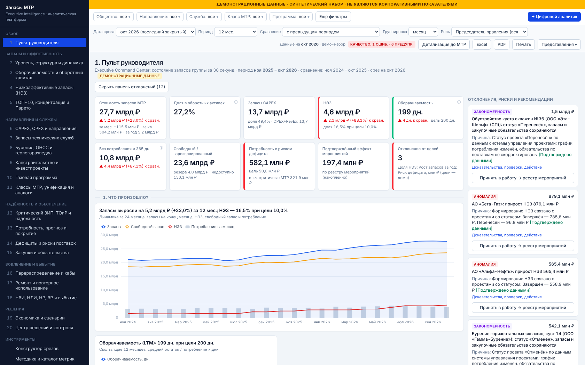

# Платформа управления запасами МТР — 20 аналитических витрин

> **ДЕМОНСТРАЦИОННЫЕ ДАННЫЕ.** Общества, объекты, МТР, поставщики, суммы и события в комплекте синтетические.
> Они не являются корпоративными показателями. Методики (пороги НЭЗ, цели, ставки) — рабочие параметры демо:
> они не подтверждены корпоративной методологией. Текст ОСК-03.06.04 v3.0 в систему не загружен.

Это интерактивное веб-приложение для диагностики, прогнозирования и управления запасами МТР. Руководитель переходит от группы
к обществу, направлению, службе, классу МТР и номенклатурной позиции. На каждом уровне он видит динамику, находит причины и риски,
сравнивает альтернативы и оформляет решение в реестре мероприятий.



## Запуск

Требования: Python ≥ 3.11, Node.js ≥ 18.

```bash
./run.sh                 # зависимости → сборка интерфейса → http://127.0.0.1:8000
PORT=9000 ./run.sh       # другой порт
REBUILD=1 ./run.sh       # принудительная пересборка интерфейса
```

При первом запуске генерируется демо-набор `backend/data/demo/*.parquet`. Генерация занимает около 20 с, seed фиксирован, поэтому результат воспроизводим.

Режим разработки:

```bash
cd backend && pip install -r requirements.txt && uvicorn app.main:app --reload --port 8000
cd frontend && npm install && npm run dev       # http://localhost:5173 (прокси /api → :8000)
```

Тесты:

```bash
cd backend && PYTHONPATH=. python -m pytest tests -q      # 24 теста
```

## Архитектура

| Слой | Технологии | Назначение |
|---|---|---|
| Данные | DuckDB (in-memory) + Parquet | Звёздная модель: позиции учёта связывают все факты со справочниками |
| Расчётный слой | Python, Pandas, NumPy, SQL | `engine.py` — единый агрегатор; `metrics.py` — единый каталог формул |
| Аналитика | `insights.py`, `forecast.py`, `scenarios.py`, `assistant.py`, `dq.py` | Отклонения и закономерности, прогноз, сценарии, помощник, качество данных |
| API | FastAPI | `/api/vitrine/{id}`, `/api/slice`, `/api/drill`, `/api/actions`, `/api/scenarios`, `/api/assistant`, `/api/export` … |
| Интерфейс | React 19, TypeScript, Vite, Tailwind CSS 4, Apache ECharts, TanStack Table | 20 витрин, сквозные фильтры, детализация, экспорт |

Ключевые принципы:

- **Единый агрегатор.** Вся логика расчётов находится на сервере, в `engine.aggregate()` и `metrics.derive()`. Фронтенд расчётов не выполняет: витрины, конструктор срезов, помощник и экспорт вызывают одни и те же функции.
- **Позиция учёта** = общество × склад × МТР × направление × служба × объект. Каждый факт привязан к позиции: остатки, движения, потребность, заказы, дефициты, выбытие, ремонтный фонд. Поэтому любой фильтр одинаково работает во всех витринах.
- **Централизованное состояние фильтров** на фронтенде (`state.tsx`) синхронизируется с адресной строкой, так что представлением можно поделиться ссылкой. Сохранённые представления хранятся на сервере.
- **Ролевой доступ** (`settings.ROLES`) применяется в одном месте, в `Ctx.access_clause()`. Пользователь общества не может расширить периметр фильтром. Данные СП скрыты от ролей без полномочий (роль «Аналитик группы»).

### Модель данных

Измерения:
- общества (ДО/СП, сегмент, регион);
- площадки, склады, ЦФО;
- направления (иерархия CAPEX / OPEX / RevEx / Коммерческая);
- технические службы;
- МТР (класс, группа, подгруппа, код НСИ, производитель, модель, критичность, ремонтопригодность, аналоги, закупочная модель);
- проекты и объекты;
- поставщики;
- оборудование (MTBF, MTTR, интенсивность отказов);
- календарь.

Факты:
- `snapshot` — остатки на конец месяца: количество, стоимость, резерв, недоступный запас, даты последнего поступления и отпуска, подтверждённая потребность на 3/6/12/24 мес., признаки НВИ/НЛИ/НР/ВР;
- `movements` — поступление, потребление, возврат, перемещения, корректировки, переоценка, реализация, списание;
- `demand` — первоначальный и оперативный план;
- `purchase_orders` — заявка, заказ, плановая и фактическая поставка, дата потребности, закупочная модель, валюта;
- `shortages`, `disposal`, `repair_fund`, `activity`, `finance`;
- `actions` — реестр мероприятий.

Состояния запаса — независимые измерения:
- НЭЗ (по настраиваемому правилу);
- свободный, зарезервированный и недоступный запас;
- признаки НВИ, НЛИ, НР, ВР (каждый отдельно);
- политика пополнения;
- балансовая принадлежность (консигнация поставщика исключается из стоимости на балансе).

**Газовая программа** — признак проекта, а не отдельное направление. Её запасы учитываются в направлениях CAPEX/OPEX ровно один раз. Это проверяется тестом и вкладкой «Качество данных».

## Реализованные витрины

Каждая витрина построена по схеме «1. Что произошло? → 2. Где? → 3. Почему? → 4. Риски → 5. Что делать?». Справа выводится панель отклонений с кнопкой «Принять в работу».

| № | Витрина | Основное содержание |
|---|---|---|
| 1 | Пульт руководителя | 10 KPI: стоимость, изменения за мес./кв./год, доля в оборотных активах, CAPEX, НЭЗ, оборачиваемость, без потребления, свободный/резерв, риск дефицита, подтверждённый эффект, отклонение от целей. Также динамика за 24 мес., структура по направлениям, тепловая карта обществ, ТОП-10, карта рисков и блок «Что требует решения руководителя» |
| 2 | Уровень, структура, динамика | Факторная диаграмма со сверкой «начало + движения + переоценка (+ расхождение учёта) = конец»; движение количества и переоценка разделены; YoY; переключение разреза; изменение структуры; аномальные месяцы (z-оценка); запасы относительно производственной активности |
| 3 | Оборачиваемость | Скользящая оборачиваемость за 12 мес.; сравнение по 8 разрезам; рейтинг ускорения/замедления; матрица «стоимость × оборачиваемость»; разложение изменения цепными подстановками; treemap отвлечения капитала; избыточное покрытие |
| 4 | НЭЗ | Помесячное разложение движения НЭЗ с точной сверкой; давность поступления и период без потребления — раздельно; матрица «возраст × стоимость × возможность вовлечения»; источники НЭЗ, подтверждённые статусом проекта; риск новых НЭЗ |
| 5 | ТОП-10 и Парето | Конструктор 16 рейтингов; концентрация 50/80/90% по 5 показателям × 5 разрезам; treemap; пузырьковая диаграмма; тепловая карта «служба × класс» |
| 6 | CAPEX/OPEX, направления | Иерархия «группа → направление → общество → служба → класс → номенклатура»; тепловая карта «направление × общество» с переключением показателя; исполнение плана; контроль двойного счёта |
| 7 | Технические службы | Критичный ЗИП, ремонтные запасы, запасы без потребности; матрица эффективности с учётом доли критичных; нормализация на единицу оборудования; унификация |
| 8 | Бурение, ОНСС, ГРР | Запасы по проектам и скважинам; заказы, сохранённые при перенесённых или отменённых работах; применение на других объектах |
| 9 | Капстроительство | Портфель: закуплено / получено / использовано / остаток / обязательства / прогноз остатка; временная шкала; матрица «прогресс × готовность МТР × остаток» |
| 10 | Газовая программа | Без двойного счёта (разложение по направлениям); дорогостоящее оборудование с отдалённым сроком востребования |
| 11 | Классы МТР, аналоги | Концентрация, изменение номенклатурного разнообразия, дубли НСИ, матрица «стоимость × частота × критичность × унификация»; предложения на техническую проверку |
| 12 | Критический ЗИП | Классификация спроса Syntetos–Boylan; λ по TSB/SES; требуемый запас — квантиль Пуассона по уровню сервиса; MTBF/MTTR; историческая проверка Croston/SBA/TSB |
| 13 | Потребность и прогноз | План (первоначальный и оперативный) против факта; смещение по службам; точность 6 методов и плана (rolling origin, без утечки будущих данных); прогноз остатка на 3/6/12 мес. с интервалом P10–P90 |
| 14 | Дефициты | Фактические и прогнозируемые дефициты; карта «вероятность × последствия × срок»; надёжность поставщиков; просрочки; закрытие дефицита перераспределением |
| 15 | Закупки | Заявки, заказы, ожидаемые поступления; закупки при наличии свободного запаса; изменение потребности после заказа; досрочные поставки; сравнение закупочных моделей без объявления «лучшей»; кандидаты на отмену |
| 16 | Перераспределение | Матрица «источник → получатель → МТР → кол-во → стоимость → потребность → логистика → согласование → решение»; решение записывается в реестр; Sankey; хабы; объединённый резерв ЗИП. Передача между обществами экономией группы не считается |
| 17 | Ремонт и повторное использование | Новая закупка / ремонт / обмен / повторное использование с учётом логистики, диагностики, гарантии и риска снижения наработки |
| 18 | НВИ, НЛИ, НР, ВР | Независимые признаки; стадии и длительности процесса; проблемы согласований. Балансовое уменьшение, денежные поступления, бухгалтерский результат и снижение расходов показаны раздельно |
| 19 | Сценарии | 11 сценариев (базовый + 10 рычагов), 18 параметров, пересчёт на сервере; последовательное использование общих пулов исключает двойной счёт. По каждому рычагу: формула, исходные данные, допущения, ограничения. Монте-Карло P10–P90; варианты «консервативный / базовый / амбициозный» |
| 20 | Центр решений | Проблемы из аналитического механизма (рейтинг по критичности и ценности); реестр мероприятий (ответственный по матрице полномочий, иначе «Требует назначения»; срок не придумывается); просрочки, повторы, план/факт эффекта; вкладка «Качество данных» |

Дополнительно:
- **Конструктор срезов:** показатель × разрез × второй разрез × время × тип визуализации.
- **Методика:** каталог 34 метрик (формула, источник, агрегация, ограничения, ответственный, статус) и редактор правил и целей с пересчётом представлений.
- **Источники данных:** адаптеры, канонические схемы, загрузка CSV, Excel и Parquet с проверкой колонок, активация набора.
- **Цифровой аналитик:** локальный движок на правилах и SQL, поддерживает 12 типов вопросов. Ответ разделён на факты, зависимости, гипотезы, прогнозы и рекомендации; в нём указаны источники, период, ограничения и ссылки на строки данных.
- **Детализация до МТР:** из любого графика или строки можно открыть номенклатурный список, затем карточку позиции (история остатков, план, движения, заказы) или применить выбранное значение как сквозной фильтр.
- **Экспорт:** Excel (все таблицы и данные графиков, лист отклонений) и PDF (кириллица, отметка ДЕМО); печать с графиками через браузер.

## Методика (ключевое)

- **Оборачиваемость, дни** = средний остаток / потребление × число дней периода. Средний остаток — хронологическое среднее по месячным срезам (среднедневных остатков в источнике нет). Групповой показатель считается из сумм, а не как среднее по обществам. При нулевом потреблении выводится статус «нет потребления».
- **НЭЗ** = часть остатка без потребления ≥ N дней, не покрытая подтверждённой потребностью на горизонте H мес. Страховой запас и критичные МТР исключаются. N и H настраиваются; по умолчанию 365 дней и 12 мес. — это не утверждённая норма.
- **Риск дефицита** = max(0, план на H мес. − свободный остаток − заказы со сроком в горизонте) × цена. Вероятность — скоринг (покрытие, срок поставки, надёжность поставщика). Последствия — критичность.
- **Причины** помечаются тремя статусами: «Подтверждено данными» (например, статус проекта), «Зависимость (не доказанная причина)» и «Гипотеза». Корреляция причиной не объявляется.
- **Эффекты сценариев** считаются относительно базового сценария. Высвобождение капитала, денежный поток, предотвращённые закупки, снижение расходов и EBITDA показаны раздельно; стоимость капитала в EBITDA не входит.

## Заложенные демонстрационные сценарии

Механизм их обнаруживает:
- перенос газового проекта УКПГ-2 и проекта обустройства СП «Эта-Шельф»;
- отмена бурения куста 14 (остатки и открытые заказы);
- изменение технического решения;
- концентрация закупок перед завершением проекта;
- систематическое завышение плана КИПиА (+49%) и АСУТП;
- скачок цен на трубную продукцию (+8%);
- ухудшение сроков поставщика S07;
- дефицит критичного ЗИП при свободном запасе в другом обществе;
- падение добычи в АО «Тета-Добыча»;
- закупки в конце бюджетного года;
- ускоренное выбытие в ООО «Эпсилон-Транспорт» (положительная практика);
- нарушения качества данных (5 типов, перечислены в таблице `dq_injected`).

## Статус тестов

`backend/tests/test_core.py` — **24 теста, все проходят**. Они проверяют:
- сверку остатков с движениями на уровне группы и позиций;
- аддитивность без двойного счёта по 5 разрезам и газовой программе;
- формулу оборачиваемости и расчёт из сумм, хронологическое среднее, нулевое потребление;
- сверку движения НЭЗ, исключение страхового запаса, настраиваемость порога;
- согласованность фильтров с разбивкой, раскрытие групп направлений;
- ролевой доступ, включая запрет доступа к чужой позиции;
- отсутствие утечки будущих данных в прогнозах, контрольные значения Croston/SBA, квантиль Пуассона;
- сценарии: суммы, пулы, Монте-Карло, нулевые параметры;
- перераспределение: источник не перерасходуется, эффект не превышает стоимость;
- обнаружение всех внесённых нарушений качества данных;
- запрет придумывать ответственного и срок;
- цепочку доказательств в находках;
- ответы 18 расчётных витрин, сценариев (19) и контроля качества (20) — HTTP 200, экспорт xlsx и pdf, 10 вопросов помощнику, детерминизм генератора.

Интерфейс дополнительно проверен в Chromium (Playwright):
- все 23 страницы открываются без ошибок консоли;
- детализация, применение фильтра, карточка позиции, помощник, решение в матрице перераспределения, ползунки сценария, «принять в работу», смена методики НЭЗ с пересчётом, ролевой доступ и конструктор срезов работают;
- на iPhone и iPad нет горизонтального переполнения.

## Ограничения

- Реальные данные и интерфейсы 1С:Шерпа, SAP / АСУЗ МТР, «Резерв», ЕФИ/НСИ, ТОиР, УИП и КХД **не предоставлены**. Готовые API не придумывались. Работают файловый адаптер (CSV, Excel, Parquet) и SQL-адаптер через DuckDB; для корпоративных систем есть настраиваемые карточки со статусом «Интерфейс не предоставлен».
- Справочники направлений, служб и классов, признаки CAPEX/OPEX и расшифровки НВИ/НЛИ/НР/ВР — демонстрационные; их нужно заменить корпоративной НСИ.
- Остатки доступны только на конец месяца. Дневные и недельные разрезы возможны для движений, но не для остатков.
- Языковая модель не подключена. Помощник отвечает только на распознаваемые типы вопросов, на остальные честно сообщает, что вопрос не распознан.
- Вероятность дефицита, нормализация «на единицу оборудования», пул ЗИП (закон квадратного корня) и потенциал хабов — упрощённые оценки. Они требуют технического и логистического подтверждения.
- Аутентификации нет: роль выбирается в интерфейсе для демонстрации ролевой модели. Для промышленной эксплуатации нужна интеграция с корпоративным SSO.
- PDF-экспорт содержит таблицы данных; печать с графиками выполняется через браузер (кнопка «Печать»).
- Первые месяцы демо-набора (2023–2024) содержат эффект «разгона» модели проектов. На периодах 12–24 мес. от последнего закрытого месяца это не сказывается.
